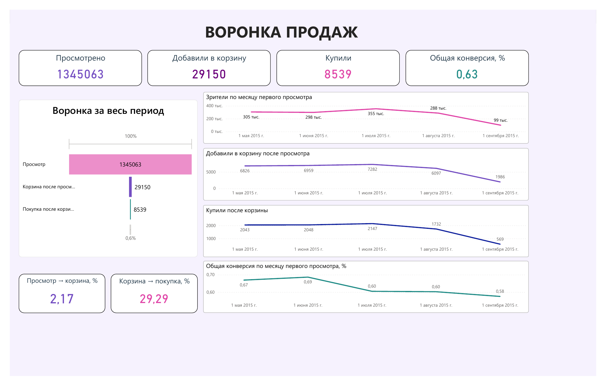

# Анализ воронки покупок интернет-магазина

**MySQL · Power BI · Retailrocket**

Анализ пути пользователей от первого просмотра товара до добавления в корзину и покупки. Цель проекта — определить, на каком этапе больше всего пользователей не продолжают заданную последовательность, сравнить месячные группы и проверить, как правила расчёта влияют на результат.

**Основной результат:** из 1 345 063 пользователей с полным семидневным периодом наблюдения 29 150 добавили товар в корзину после просмотра, а 8 539 затем совершили покупку. Общая конверсия строгой воронки — **0,63%**.

При этом ещё **1 088 пользователей купили после просмотра, но не прошли полную последовательность событий**. Поэтому непрохождение воронки нельзя автоматически считать отсутствием покупки.

## Дэшборд

[Открыть PDF](dashboard/retailrocket_funnel.pdf) · [Скачать файл Power BI](dashboard/retailrocket_funnel.pbix)

На одной странице представлены:

- количество пользователей на трёх этапах;
- общая воронка за семь суток;
- конверсии между этапами;
- динамика зрителей, добавивших в корзину и покупателей по месяцу первого просмотра;
- общая конверсия месячных групп.

Дэшборд показывает пользовательскую воронку. Название карточки «Просмотрено» на изображении означает число пользователей с которые просмотрели товар. Графики по месяцам также показывают пользователей соответствующих групп, а не события, совершённые в данном месяце.

## Данные

Источник — [Retailrocket recommender system dataset на Kaggle](https://www.kaggle.com/retailrocket/ecommerce-dataset).

В проекте использован файл `events.csv` с обезличенными событиями интернет-магазина. Идентификаторы не раскрывают названия товаров или личности пользователей.

| Поле | Содержание |
|---|---|
| `timestamp` | Время события в миллисекундах Unix |
| `visitorid` | Идентификатор пользователя |
| `event` | `view`, `addtocart` или `transaction` |
| `itemid` | Идентификатор товара |
| `transactionid` | Идентификатор заказа; для остальных действий отсутствует |

Период событий — **3 мая — 18 сентября 2015 года**.

| Показатель исходных данных | Значение |
|---|---:|
| События | 2 756 101 |
| Уникальные пользователи | 1 407 580 |
| Уникальные товары в событиях | 235 061 |
| Уникальные заказы | 17 672 |
| События `transaction` | 22 457 |

**Событие покупки, заказ и покупатель — разные единицы анализа.** Один заказ может содержать несколько товарных событий, а один пользователь — совершить несколько заказов.

Таблицы `item_properties_part1`, `item_properties_part2` и `category_tree` в выполненных расчётах не использовались. Анализ категорий, наличия товаров и возвращений к конкретным товарам в текущий проект не входит.

## Подготовка данных

В [первом SQL-файле](sql/01_data_quality.sql) выполнены проверки структуры, количества записей, периода наблюдения, типов событий, заполненности `event` и `transactionid`, а также полных дубликатов.

Обнаружено **458 групп полных дубликатов**. После `SELECT DISTINCT` осталось **2 755 641 событие**, то есть удалено **460 лишних строк**. Число групп повторов и число удалённых строк различается, поскольку в группе может быть больше двух одинаковых записей.

Очищенные данные сохранены отдельно в `events_clean`. Исходная таблица `events` не изменяется.

Дополнительно проверены заказы, события которых попадают на разные календарные даты. Само по себе это не служит основанием для удаления записей: нужно учитывать время регистрации и часовой пояс.

Для соединений событий с пользователями создан составной индекс `(visitorid, timestamp)`. Он соответствует поиску событий одного пользователя в заданном временном интервале. Ускорение в процентах не оценивалось.

## Правила воронки

Воронка строится **по пользователям**, с соблюдением порядка:

**Первый просмотр → первая подходящая корзина → первая подходящая покупка.**

1. Для каждого пользователя определяется первый зарегистрированный `view`.
2. В расчёт включаются только пользователи, для которых после этого просмотра доступны полные семь суток до конца данных.
3. Корзина должна появиться строго после просмотра и не позднее чем через семь суток.
4. Покупка должна появиться строго после корзины и также уложиться в семь суток **от первого просмотра**.
5. Если подходящего события нет, время соответствующего этапа остаётся `NULL`.

Например, если корзина появилась на шестые сутки, на покупку остаётся примерно один день. События с одинаковым временем не удовлетворяют условию «строго после».

| Производная таблица | Назначение |
|---|---|
| `first_views` | Первый зарегистрированный просмотр каждого пользователя |
| `funnel_users` | Пользователи с полными семью сутками наблюдения |
| `first_carts` | Первая корзина после просмотра в пределах окна |
| `first_purchases` | Первая покупка после корзины в пределах того же окна |

Расчёт реализован в [sql/02_sales_funnel.sql](sql/02_sales_funnel.sql) через `LEFT JOIN`, условия времени и `MIN`. `LEFT JOIN` сохраняет пользователей, которые не дошли до следующего этапа.

## Результаты

### Общая воронка за семь суток

| Этап | Пользователи | Конверсия с предыдущего этапа | Доля от первого этапа |
|---|---:|---:|---:|
| Просмотр | 1 345 063 | — | 100,00% |
| Корзина после просмотра | 29 150 | 2,17% | 2,17% |
| Покупка после корзины | 8 539 | 29,29% | 0,63% |

| Переход | Не прошли к следующему этапу | Доля от предыдущего этапа |
|---|---:|---:|
| Просмотр → корзина | 1 315 913 | 97,83% |
| Корзина → покупка | 20 611 | 70,71% |

Основной отток **из заданной последовательности** происходит до добавления в корзину. Это помогает выбрать направление дальнейшего исследования, но не устанавливает причину: по этим данным нельзя сделать вывод, что проблема вызвана ценой или интерфейсом.

### Месяц первого просмотра

Пользователь относится к месяцу первого просмотра. Последующие действия учитываются в этой же группе, даже если произошли в следующем месяце.

| Месяц 2015 года | Зрители | Добавили в корзину | Купили | Просмотр → корзина | Корзина → покупка | Общая конверсия |
|---|---:|---:|---:|---:|---:|---:|
| Май | 305 250 | 6 826 | 2 043 | 2,24% | 29,93% | 0,67% |
| Июнь | 298 381 | 6 959 | 2 048 | 2,33% | 29,43% | 0,69% |
| Июль | 355 023 | 7 282 | 2 147 | 2,05% | 29,48% | 0,60% |
| Август | 287 507 | 6 097 | 1 732 | 2,12% | 28,41% | 0,60% |
| Сентябрь | 98 902 | 1 986 | 569 | 2,01% | 28,65% | 0,58% |

- В июле самая большая группа зрителей и больше всего завершивших воронку пользователей, но общая конверсия ниже, чем в июне.
- Среди полных календарных месяцев июнь имеет самую высокую общую конверсию — 0,69%.
- В августе переход из корзины в покупку составляет 28,41%, тогда как в июне и июле — около 29,4–29,5%.
- **Май и сентябрь представлены не полностью.** Низкий объём сентября нельзя напрямую трактовать как снижение активности за полный месяц. Для каждого включённого пользователя при этом соблюдается полное семидневное окно.

Суммы месячных количеств совпадают с общей воронкой. Общая конверсия рассчитывается из сумм пользователей, а не как среднее месячных процентов.

### Проверка окна: одни и семь суток

Сравнение проведено на **одной и той же группе из 1 345 063 пользователей**.

| Показатель | За 24 часа | За 7 суток |
|---|---:|---:|
| Добавили в корзину | 27 221 | 29 150 |
| Завершили воронку | 7 662 | 8 539 |
| Просмотр → корзина | 2,02% | 2,17% |
| Корзина → покупка | 28,15% | 29,29% |
| Общая конверсия | 0,57% | 0,63% |

**89,73% завершивших семидневную воронку сделали это в первые сутки.** Дополнительное время позволяет учесть ещё 877 пользователей, или 10,27% завершивших путь. Вывод об основном этапе оттока сохраняется при обоих окнах.

### Покупатели вне строгой воронки

Дополнительно найдены все пользователи с покупкой после первого просмотра в пределах семи суток, без обязательного прохождения корзины.

| Группа | Пользователи |
|---|---:|
| Все покупатели после просмотра за семь суток | 9 627 |
| Прошли полную последовательность | 8 539 |
| Купили, но не прошли полную последовательность | 1 088 |
| Из них: нет подходящей записи корзины после просмотра | 1 041 |
| Из них: корзина есть, но порядок не подходит | 47 |

**11,30% покупателей не вошли в последний этап строгой воронки.** Конверсия из просмотра в покупку без требования корзины составляет **0,72%**, а конверсия прохождения всей последовательности — **0,63%**.

Это не доказывает ошибку сбора данных или покупку вообще без корзины. Корзина могла быть зарегистрирована до первого просмотра, одновременно с покупкой, позже неё или не попасть в данные. Проверка относится только к событиям в определённом окне.

Дополнительные расчёты находятся в [sql/03_additional_checks.sql](sql/03_additional_checks.sql).

## Что можно проверить дальше

| Наблюдение | Гипотеза для проверки | Нужные данные или анализ |
|---|---|---|
| Низкий переход от просмотра к корзине | Часть товаров не соответствует интересам пользователя или недоступна | Сравнение товаров и категорий, доступность на момент просмотра |
| После корзины полную последовательность завершают 29,29% пользователей | На дальнейших шагах возникают препятствия | Этапы оформления, ошибки оплаты, условия доставки |
| Месячные конверсии различаются | Меняется состав аудитории или товарный интерес | Источники трафика, товары, категории и проверка регистрации событий |

Эти гипотезы не являются установленными причинами или доказанными способами повышения конверсии.

## Файлы проекта

| Файл | Назначение |
|---|---|
| [01_data_quality.sql](sql/01_data_quality.sql) | Исследование исходных данных, очистка дубликатов, индекс |
| [02_sales_funnel.sql](sql/02_sales_funnel.sql) | Построение последовательной воронки и основные метрики |
| [03_additional_checks.sql](sql/03_additional_checks.sql) | Недельные группы, сравнение окон и покупатели вне воронки |
| [04_dashboard_exports.sql](sql/04_dashboard_exports.sql) | Выгрузки для Power BI: `funnel.csv`, `monthly_funnel.csv`, `weeks.csv` |
| [retailrocket_funnel.pbix](dashboard/retailrocket_funnel.pbix) | Финальный редактируемый отчёт Power BI |
| [retailrocket_funnel.pdf](dashboard/retailrocket_funnel.pdf) | Экспорт дэшборда |
| [dashboard.png](dashboard/dashboard.png) | Изображение дэшборда для просмотра на GitHub |
| CSV в папке `dashboard` | Небольшие агрегированные выгрузки, сохранённые в финальном PBIX |

## Как повторить анализ

1. Скачать `events.csv` из исходного набора и импортировать его в MySQL в таблицу `retailrocket.events`. `timestamp` хранить как `BIGINT`; пустой `transactionid` импортировать как `NULL`, а не как ноль.
2. Выполнить SQL-файлы с `01` по `03`. Используются обычные агрегирования, `LEFT JOIN`, `CASE WHEN`, `UNION ALL` и функции даты; код рассчитан на MySQL 8.
3. Для выгрузок выполнить отдельные запросы из файла `04`. Каждый результат экспортировать в свой CSV с заголовками.
4. Открыть `dashboard/retailrocket_funnel.pbix` в Power BI Desktop. Для просмотра достаточно уже загруженных данных.
5. Для обновления положить три CSV в `C:\Power BI\` или изменить пути источников в Power Query, затем нажать «Обновить».

Производные таблицы в SQL пересоздаются для повторного расчёта. Исходная таблица `events` не удаляется.

В сохранённом PBIX `funnel.csv` читается с разделителем `;`, остальные CSV — с разделителем `,`; кодировка источников — Windows-1251. Приложенные CSV соответствуют этим настройкам. При экспорте в UTF-8 нужно также изменить кодировку источника в Power Query.

Часовой пояс влияет на границы календарных дней, недель и месяцев. Все календарные выгрузки следует выполнять в одной сессии с одинаковыми настройками. Файлы SQL показывают `@@session.time_zone` и `@@system_time_zone`, но не меняют их автоматически: исходная настройка сеанса не была отдельно зафиксирована.

Месячные поля с окончанием `_pct` имеют шкалу **0–100**, а недельные коэффициенты в `weeks.csv` — **0–1**. Например, `0.67` в месячной выгрузке означает 0,67%, а `0.0067` в недельной — ту же долю. Для расчётов в Power BI текстовые десятичные значения с точкой нужно преобразовывать с подходящей локалью; количества пользователей уже являются числовыми.

Недельный анализ включён в SQL как дополнительный срез. В сохранённом отчёте таблица `weeks` присутствует в модели, но не используется на опубликованной странице. Недельные экстремумы не включены в основные выводы проекта.

## Ограничения

- Первый просмотр означает первый **зарегистрированный в наборе** просмотр. Пользователь мог посещать магазин раньше.
- Анализ ведётся по пользователям, не по сессиям и не по одному и тому же товару: `itemid` между этапами может различаться.
- События с одинаковой отметкой времени не проходят строгое условие порядка.
- Семь суток — выбранное аналитическое окно, а не доказанная оптимальная длительность. Более поздние покупки не учитываются.
- Количество строк `transaction` не равно количеству заказов или уникальных покупателей.
- По имеющимся полям не рассчитываются выручка, средний чек или финансовый эффект рекомендаций.
- Причины оттока, различия источников трафика и статистическая значимость месячных различий не исследовались.

Исходный файл событий в репозиторий не включён. В нём опубликованы SQL, небольшие агрегированные выгрузки и дэшборд; полные данные доступны у источника.
